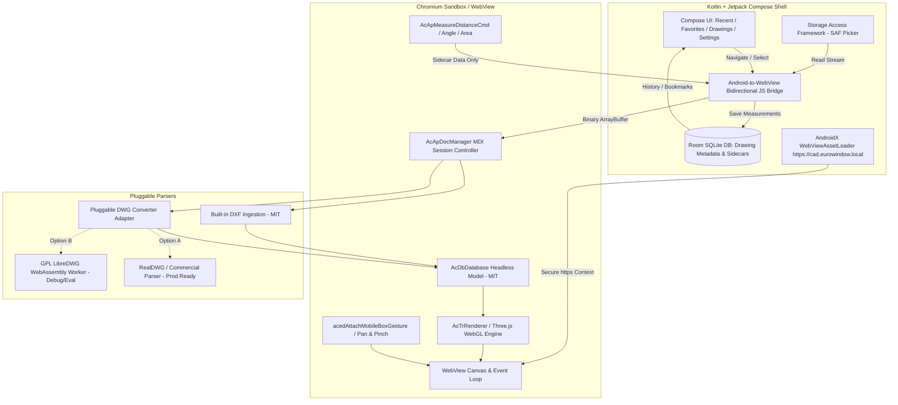

# Architecture & System Design — Eurowindow CAD Viewer (P0)

**Application ID:** `com.eurowindow.cadviewer`  
**Platform:** Android (Kotlin + Jetpack Compose) + Embedded MLightCAD Web Runtime  
**Lead Architect:** Antigravity  

---

## 1. High-Level Architecture Overview



---

## 2. Component Design

### 2.1 Native Android Shell (Kotlin / Jetpack Compose)
- **Activity & Navigation:** Single Activity architecture (`MainActivity`) with Jetpack Compose Navigation.
- **Modern Tabs (DWG FastView Inspired):**
  1. *Recent:* Last opened drawings with timestamps, file size, and quick-open.
  2. *Favorites:* Starred engineering drawings for fast field access.
  3. *Drawings:* File browser integrated with Android SAF and app-private cache.
  4. *Settings:* Unit preferences (mm, cm, m, inch, feet), precision settings, dark theme toggles, and license information.
- **Metadata Database (Room):** Stores metadata (file name, original URI, last opened timestamp, favorite flag, user measurement sidecars). **Never modifies the source drawing file.**

### 2.2 Viewer Bridge Interface (`CadEngine`)
```kotlin
interface CadEngine {
    suspend fun initialize()
    suspend fun openDrawing(fileName: String, stream: InputStream): DrawingResult
    suspend fun closeDrawing()
    suspend fun getLayers(): List<CadLayer>
    suspend fun setLayerVisibility(layerId: String, visible: Boolean)
    suspend fun zoomToFit()
    suspend fun setMeasurementMode(tool: MeasurementTool)
    suspend fun clearMeasurements()
    suspend fun getDrawingInfo(): DrawingInfo
}
```

### 2.3 Strict Security & Integrity Policy
- **Zero In-Place Overwrites:** Files opened via SAF are treated as strictly immutable.
- **SHA-256 Verification Gate:** In Phase P0.7, every drawing will have its hash verified before opening and after closing to guarantee `SHA256_before == SHA256_after`.
- **Zero Cloud / Analytics SDKs:** 100% offline; no network permissions requested in `AndroidManifest.xml` (except optional local webview loopback if required by older API levels, though `WebViewAssetLoader` operates fully in-process without network permissions).
